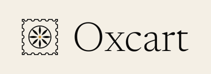
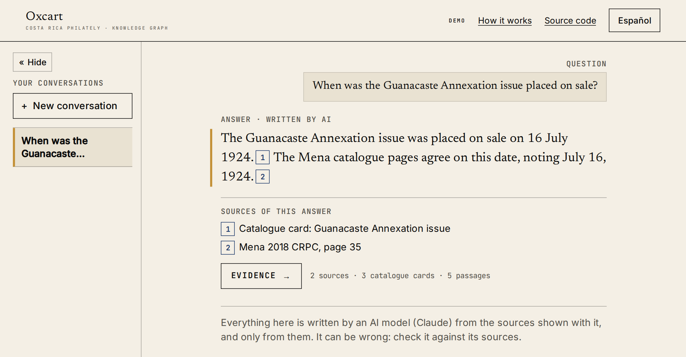
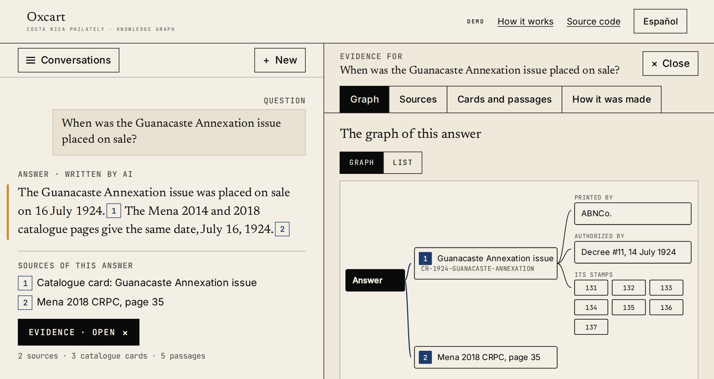
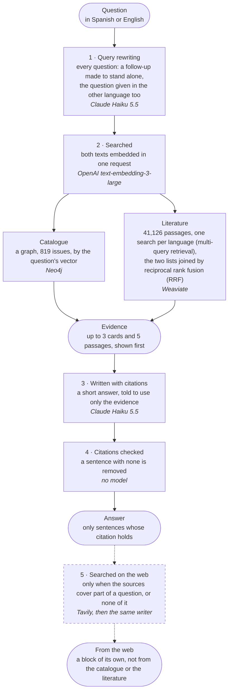

<p align="center">
  
</p>

<div align="center">
  <a href="LICENSE"></a>
  
  
  
  
  
</div>

# Oxcart — a knowledge graph and retrieval system for Costa Rican philately

Ask about Costa Rican stamps; get a short answer in which every sentence cites its catalogue card or page.

**Try it: [oxcart.chat](https://oxcart.chat).** How it works and how it was measured, on one page:
[oxcart.chat/how-it-works](https://oxcart.chat/how-it-works). The demo runs on free hosting tiers and sleeps when
nobody uses it; waking it takes about half a minute ([how it is run](docs/OPERATIONS.md)).

<p align="center">
  
  <br><em>The first screen: the question box, stored examples, and a plate of stamps from the literature the demo searches.</em>
</p>

<p align="center">
  
  <br><em>A catalogue question: a short answer, each sentence with the card or page it cites.</em>
</p>

<p align="center">
  
  <br><em>Evidence on the graph: what the answer cites, and what was found but not cited.</em>
</p>

<p align="center">
  
  <br><em>A literature question in Spanish: the answer, its sources, and the figure of a cited page.</em>
</p>

Pictures of the page built from this repository, running against the hosted stores. The first and the last hold
crops of the scanned literature and are served, as the page's figures are, from the figures host.

## Results, in short

151 questions in Spanish and English: 80 on the catalogue, 41 on the literature, 30 out of scope. One run of
this version's code on a development machine, against the hosted stores, on 24 November 2026, except the first
row, which is the catalogue lookup alone; the method, every table and every limit are in
[EVALUATION.md](EVALUATION.md), with the same questions asked the same day with the code as it was before the
literature was searched in both languages
([the before and after](EVALUATION.md#the-same-questions-before-and-after)).

| Measure | Result |
|---|---|
| Issue found: top-1 / top-3 accuracy | 29 of 32 (91%) / 32 of 32 held-out catalogue questions, through the lookup as served. The 32 were kept aside while the lookup was built, then reused, with the other 48, when the short vector it serves was chosen |
| Page found: hit@5 | A question counts when a page graded 2 (its passages hold the answer, or a clear, direct part of it) is among the five passages: 38 of 41 literature questions (93%), against 36 with the question searched in its own language only; 38 of 49 counting the 8 draft questions left out of the set because the pooled search results held no page that answers them |
| Passages in both languages | 119 of the 121 catalogue and literature questions get passages in Spanish and in English among the five shown, against 38 before |
| Catalogue answers: answer accuracy and faithfulness, graded by a model | 74 of 80 state the value the catalogue holds; in 62 of 80 every sentence is stated by its sources, the cards and pages it cites (a card is one issue's record in the Mena catalogue graph) |
| Literature answers: agreement with a reference answer, graded by a model | Against a reference answer (an answer a model wrote from the pages it graded for that question), the judge's first pass: 8 of 41 agree with it on what the question asks, 32 in part (part of it, or only related facts). A second pass, told that detail the question did not ask for does not count: 15 of 41 give the thing asked |
| Citations that did not hold; sentences removed | Every question of the run, out of scope and follow-ups too: 0 of 383 citations did not hold; 103 of 436 sentences were removed because the model wrote them with no citation |
| Out of scope: no written answer | 28 of 30 (93%) got no written answer; the writer is told to answer nothing outside the scope. The other 2 got an answer: `oos-009-en` (outside the scope) and `una-008-es` (about Costa Rican stamps, with no answer in the sources; an answer marked as part) |
| Cost per question (answer model only; embeddings and web search apart) | median 0.00084 USD, p95 0.00137 USD (mean 0.0009, max 0.00154): two model calls, of which the query rewriting is 0.00018 USD |
| Latency | On the development machine: evidence on the page, median 4.27 s, p95 5.57 s; checked answer, median 6.79 s, p95 10.65 s. The query rewriting takes 1.03 s (median) of the first. Through the public service, version 1.0 showed the evidence after 1.04 s (median); this version has not been measured there |

**Limits.** Searching the literature in both languages finds more, and by the judge's marks the written
answers did not rise with it: in three runs before and three after, the same day, the literature answers that
agree in full with their reference were 10, 10 and 10 of 41 before and 8, 8 and 7 after, and the catalogue
answers that state the catalogue's value 77, 76 and 78 of 80 before and 74, 75 and 77 after. The references
were written from pages the old search had found, so part of that may be the measure's
([EVALUATION.md](EVALUATION.md#the-same-questions-before-and-after)). On 50 questions never used while the system was changed (the sealed set, made on 21 November 2026),
asked on 22 November 2026 once with the code of 21 November (commit `d27e269`) and once with the code of 22
November (commit `5dae0c1`, the short vector on), no literature answer agreed with its reference on what the
question asks (0 of 20 in both runs); 2 of 20 with `d27e269` and 4 of 20 with `5dae0c1` gave the thing asked; 17
and 18 of 20 catalogue answers were correct. Both runs are of code older than this version; the sealed set was
not run again. The grades,
and the literature gold (the pages that answer each question), are a model's and no person has checked them; a
second model gave the same grade to 39 of 45 pages of a blind sample. The catalogue questions were generated from
the same graph the answers read, so they test finding the issue, not the catalogue. The sets are small: one
question is 1.25 points of 80, about 2.4 of 41, about 3.1 of 32, about 3.3 of 30 and 5 of 20. The writer is told
to use only the evidence; the check tests that a citation names a card or passage that was shown and that its
cited text is in it, on sentences cut by a rule, and not that the sentence follows from that text. A web part
changes from one asking to the next and has no reference answer to be graded against; the run of the table asks
for none, and in a trial of 26 real searches 28 of 35 shown web sentences were supported by the page they cite.

## A question, step by step

Oxcart answers questions about Costa Rican stamps, in Spanish or English, from two sources: the Mena catalogue,
held as a graph in Neo4j (819 issues, 2,764 stamps), and 41,126 passages of scanned philatelic literature, held
with their vectors in Weaviate. The literature is in both languages, and a question's vector brings back
passages of its own language almost only, so every question is searched in both. First, query rewriting: one
call to Claude Haiku 5.5 makes a follow-up stand alone and gives the question in the other language. Then the
question's vector (OpenAI `text-embedding-3-large`) finds the issue in the catalogue, while the literature is
searched once with each text (multi-query retrieval) and the two lists are joined by reciprocal rank fusion
(RRF). Claude Haiku 5.5 writes a short answer with citations, in the language of the question, and a sentence is
shown only if its citation holds. A passage is shown in its own language; nothing is translated. The steps are
a LangGraph graph in a FastAPI backend in Python; the page is Next.js and React in TypeScript.



Rounded: what is on the page. Square: a step in the backend. Dashed: a step for some questions only. Step 1
runs for every question, a conversation's first one too; when its call fails or is late the question is searched
as it was typed, in its own language only, and when one of the two literature searches fails the other's list is
used alone. The server keeps no question's text and no conversation between two requests: a conversation lives
in the browser. It holds in memory the vectors of the last 256 texts it searched (a question and its translation
are two), with no text, and keeps no answer. A language model writes the
answer and is told to use the evidence that is shown and nothing else; the check tests that each citation names
that evidence and holds its cited text, not that the sentence follows from it. When the model says the evidence
does not cover the question, the page says so and shows the evidence.

## Run it locally

You need Python 3.10+, Node.js 20+, a Neo4j database holding the graph, and a Weaviate instance holding the `Oxcart`
collection (Weaviate 1.32.4 locally, which `docker-compose.yml` starts; 1.40.5 hosted). The data itself is not
distributed; see [Data](#data).

```bash
git clone https://github.com/TecnologiasVM/oxcart.git
cd oxcart

# 1. configuration: copy the template and fill in the Neo4j and Weaviate settings
cp .env.example .env

# 2. backend dependencies, in a virtual environment
python -m venv .venv
source .venv/bin/activate            # Windows: .venv\Scripts\activate
python -m pip install -r backend/requirements.txt
python -m pip install -e .           # the shared modules, as the oxcart package

# 3. frontend dependencies
cd frontend && npm ci && cd ..

# 4. start both servers, check them, stop them
python scripts/servers.py start
python scripts/servers.py status
python scripts/servers.py stop
```

Open <http://localhost:3000> for the question page, and <http://localhost:3000/research> for the First Issue
explorer. `GET /api/health` reports whether Neo4j and Weaviate are reachable.

Tests:

```bash
# what the workflow runs on every pull request: no database and no key needed
python -m pip install pytest
python -m pytest eval/tests oxcart/tests pipeline/first_issue_graph/tests backend/tests
cd frontend && npx playwright install chromium
npx playwright test                                                # the browser tests; the backend is mocked

# these need the stores
npx playwright test --config=playwright.shadow.config.ts           # the explorer's suite, needs both servers running
cd ../backend && python test_mena_backend.py                       # needs Neo4j (and Weaviate for evidence)
```

The two that need the stores last ran on 2026-11-18, on a clean Linux machine against the stores, and passed; they
have not run since. `servers.py` was tested on Linux. It is written to work on Windows and macOS and has not been
run there yet.

## What works today

What runs today is retrieval and, on top of it, a short written answer with citations. The hosted demo is the
question page and the page on how it works; the explorer app for the 1863 First Issue runs locally and writes
no answer.

- **A domain graph in Neo4j** built from the Mena 2018 catalogue: issues, stamps, varieties, proofs, plates, and
  equivalences to Scott numbers.
- **A literature index in Weaviate**: 192,680 text chunks from 1,424 documents (journals, monographs, bulletins,
  catalogues). The documents were published from 1952 to 2025 and cover stamps from 1863 to 2025. See
  [docs/PHILATELIC_LITERATURE.md](docs/PHILATELIC_LITERATURE.md).
- **A First Issue evidence graph**: 653 passages from 296 documents linked to the 1863 First Issue and to its
  individual stamps by a rule-based linker, with no language model.
- **An explorer app** (`backend/`, `frontend/`): a FastAPI backend and a Next.js frontend with four views:
  Overview, Explore (the graph), Query (ask and read the evidence), and the Mena Catalogue by year. How it
  indexes, links and ranks, and how it was checked: [docs/EXPLORER.md](docs/EXPLORER.md).
- **A question page and the path behind it** (the site root, `POST /api/ask`): ask about any Costa Rican issue
  in Spanish or English and read the evidence, the catalogue issue and the passages of the literature. The
  conversation stays in the browser; there are no accounts. This is the page the hosted demo serves.
- **A written answer with citations, as a graph** (`POST /api/chat`, `backend/app/answer_graph.py`, LangGraph).
  Four steps: `contextualize` is query rewriting, for every question (a follow-up becomes a question that
  stands alone, and the question is given in the other of Spanish and English), `retrieve` is the question path
  with the literature searched once per language and the two lists joined by reciprocal rank fusion, `write`
  asks the model for a short answer with citations, `check` keeps the sentences whose citation holds and drops
  the rest.
  - *Why a graph:* each step is given only the part of the state it declares. The earlier turns of a conversation
    come from the browser, so they are a visitor's text, and `contextualize` is the only step that receives them;
    the step that writes the answer gets the question that stands alone and the evidence. Each step's result is
    sent as it ends, so the evidence arrives as fast as before and the answer follows.
  - *Why no checkpointer:* a conversation lives in the visitor's browser, which sends its last three turns with a
    follow-up. The server keeps no question's text and no conversation between two requests (in memory it holds
    the vectors of the last 256 texts it searched, with no text, and no answer), so no visitor's text stays in its memory
    and nothing of a conversation is lost when the service sleeps.
  - *What it does not do:* no step grades the evidence, none retrieves a second time, and there is no scope
    router; a rule in the model's instructions stands in for the last. What was measured for them is under
    [Future work](#future-work).
- **A web part, on at the hosted demo and off by default in the code** (`POST /api/chat/web`,
  `backend/app/web_step.py`). When the catalogue and the literature do not cover an in-scope question, or answer
  part of it, the page can add a short part written from one web search, in a marked block of its own under the
  answer, with the pages it cites.
  - *How it is asked:* the write call says which of three things happened (outside the scope, not covered,
    part only). The answer from our sources comes first; the page then asks for the web part in a request of
    its own, with a ticket the backend signed. Making that ticket can hold the answer back by one read of the
    search service's usage (its timeout is 4 s), at most once in five minutes, and only for an answer that
    asks for the web.
  - *Scope, and what a search holds:* the writer is told to mark a question outside the scope, which then gets
    no answer and no ticket. The mark is the model's judgment: in the published run one question outside the
    scope got a part answer, and with it a ticket ([EVALUATION.md](EVALUATION.md#as-served-two-runs-of-the-whole-set-with-the-web-setting-on)).
    The search query is the question as it was searched (for a follow-up, as the rewrite step wrote it) and
    fixed words: nothing of an answer a model wrote is in it, and nothing a model writes becomes a link.
  - *Two settings turn it on:* `ASK_WEB` on the backend (with a search key) and `NEXT_PUBLIC_WEB` in the page's
    build. A page built without the second ignores the ticket and makes no request, so a search can only start
    from a page whose privacy details name the search service.
  - *Measured before it was turned on,* on the development questions
    ([EVALUATION.md](EVALUATION.md#a-web-part-three-markers-and-a-trial-with-real-searches)): a web sentence can
    be checked against the page it cites, not for being right.
- **A test set and a retrieval evaluation** (`eval/`, [EVALUATION.md](EVALUATION.md)): 151 questions in Spanish
  and English, and a measured choice of a 41,126-passage subset of the literature index that answers more of them
  than the full index does. The gold for the literature questions is judged by a model, not yet by a person.
- **A catalogue lookup for any issue** (`oxcart/catalogue_lookup.py`): finds the issue a question
  is about, in Spanish or English, with no language model. The question path calls it for every question.

The corpus, the databases and the page images are **not in this repository**; see [Data](#data).

More:

- [EVALUATION.md](EVALUATION.md): what was measured, on which questions, and how far the numbers can be trusted.
- [docs/EXPLORER.md](docs/EXPLORER.md): the First Issue explorer, its linker, its graph and its checks.
- [docs/OPERATIONS.md](docs/OPERATIONS.md): the hosted demo's hosts, limits, web search and spend.
- [backend/README.md](backend/README.md): the API, its settings, its tests and its image.
- [frontend/README.md](frontend/README.md): the page.

## Future work

Not built. No order and no date.

- **The literature answers.** What was measured ([EVALUATION.md](EVALUATION.md#what-was-tried-to-raise-the-literature-answers)):
  - *The right pages and more of their text, together, move them.* Given passages of pages known to answer, at up
    to 4,000 characters each, the writer gives what is asked for 21 to 27 of 41 questions, against 14 to 19 as
    served. No search can know those pages; the figure says what better evidence would be worth.
  - *Either one alone does not.* More text of the passages the search finds (2,000 or 4,000 characters) changes
    nothing, and the right pages at 700 characters give about three more answers in full.
  - *A stronger writer* on the same evidence agrees in full more often (15 or 16 of 41 against 10 to 12) at about
    fifteen times the cost of a question, and gives what is asked about as often.
  - *A step that grades the evidence and may search once more* came nearest among what could be served (about
    three more answers in full) for 60% more cost and a later first line on the page. It was not kept.
  - *Showing more of a passage than 700 characters* on the page is a decision about the publications, not a
    technical one.
- **A review of the grades by a person.** The gold of the literature questions and the grades of the written
  answers are a model's.
- **The web to complete more answers.** Today one search adds a short part under an answer that the sources
  cover in part or not at all.
- **A photo of a stamp as the question.**
- **Reading the source PDFs again.** Not measured: the literature's text was extracted once.
- **A picture of the stamp on a catalogue answer.** No catalogue card has one today.
- **Spanish answers that keep English words.** A Spanish answer at times keeps a date or a name in the English of
  the passage it cites, and a few catalogue acts keep an English body's name inside their number.
- **The explorer beyond the First Issue.** The question page takes any Costa Rican stamp question; the explorer's
  graph views cover the 1863 First Issue only.
- **Timeouts inside the store clients, and a bound on concurrent chats.** A question's deadline stops waiting for
  a store, not a call already under way: the vector store's client has its own timeouts, the graph's driver has
  none set, and the catalogue has four threads and the literature eight.
- **The web usage read off the answer's path.** Today it can hold back the answer that makes it (above).
- **Judging the exact evidence the writer received, and the excerpts shown.** The answer judge reads a card's
  whole record, where the writer reads selected lines; a page's grade counts for any passage of that page, where
  the page shows 700 characters of it.
- **A run manifest, with retries, for every published run:** the commit, the settings, the collection, and each
  question's attempts and failures.
- **A small redistributable fixture** to run the whole path end to end from this repository.
- **A set of questions written by collectors.**

## Stack

| Layer | What the code uses | Where |
|---|---|---|
| Graph | Neo4j, queried with Cypher | `neo4j_utils/`, `pipeline/first_issue_graph/`, `oxcart/` |
| Search | Weaviate 1.32.4 locally (docker-compose), 1.40.5 hosted. The question page: vector search (`near_vector`) with OpenAI `text-embedding-3-large` vectors (3,072 dimensions) made by the backend, the literature once with the question and once with its text in the other language, the two lists joined by reciprocal rank fusion in the backend; keyword search (BM25) when no embedding can be made. The explorer: keyword search (BM25) by default, with a `hybrid` pass when an OpenAI key is set | `backend/app/ask_service.py`, `oxcart/retrieve.py`, `docker-compose.yml` |
| API | FastAPI, Pydantic v2 | `backend/requirements.txt` |
| Written answer | Claude Haiku 5.5 through Anthropic's API, with its citations feature; the steps as a LangGraph graph | `backend/app/answer_model.py`, `backend/app/answer_graph.py` |
| Web part (off by default; on at the hosted demo) | Tavily's search API: one basic search of five results; the part written by the same model, with citations | `backend/app/web_step.py` |
| UI | Next.js, React, TypeScript, Cytoscape | `frontend/package.json` |
| Tests | Playwright for the page (the backend mocked) and for the explorer (against the stores); pytest for the question path, the eval, the catalogue lookup and the linker | `frontend/tests-e2e/`, `frontend/tests/`, `backend/tests/`, `eval/tests/`, `oxcart/tests/`, `pipeline/first_issue_graph/tests/`, `tests/` |
| Parsing | Dolphin | `third_party/dolphin/` |
| Earlier prototype and catalogue parsing | LangChain, Gradio | `pipeline/mena_stamp_agent.py`, `notebooks/`, `neo4j_utils/neo4j_gradio_VIS.py` |

## Repository map

| Path | What it holds |
|---|---|
| `backend/` | The API (FastAPI): the question path and the explorer's routes, its tests and its Dockerfile. See its [README](backend/README.md). |
| `frontend/` | The page (Next.js): the question page and the explorer under `/research`. See its [README](frontend/README.md). |
| `oxcart/` | The modules the backend and the eval share, as a Python package: settings, the catalogue lookup, retrieval. Installed with `python -m pip install -e .`. |
| `eval/` | The evaluations: retrieval (measures, search arms, the catalogue question generator, pooling, page judging, scoring) and the written answers (`chat_arm.py`, `answer_judge.py`). Results and method in [EVALUATION.md](EVALUATION.md). |
| `scripts/` | `with-key.sh`: runs one command with keys taken from the machine's secret store, without writing them to a file. `load_cluster.py`: rebuilds the literature collection on a Weaviate Cloud cluster from an export. `servers.py`: starts, checks and stops the backend and the frontend on this machine. |
| `neo4j_utils/` | Loading the Mena catalogue into Neo4j, indexes, search, and a Cypher cookbook. |
| `pipeline/` | Parsing, chunking, enrichment and indexing of the literature; catalogue parsing. `pipeline/first_issue_graph/` holds the First Issue graph build and linker; start with its [README](pipeline/first_issue_graph/README.md); the audit of the First Issue evidence graph is its [EVALUATION.md](pipeline/first_issue_graph/EVALUATION.md). |
| `notebooks/` | Research notebooks, without outputs, including the earlier Gradio question-answering prototype. |
| `third_party/dolphin/` | The Dolphin document parser (ByteDance, MIT). |
| `docs/` | The explorer ([EXPLORER.md](docs/EXPLORER.md)), how the hosted demo is run ([OPERATIONS.md](docs/OPERATIONS.md)), the literature catalogue and working notes. |
| `tests/` | Tests for the pipeline modules. |

## Data

This repository holds code and documentation. It does not hold the scanned literature, its extracted text, the page
images, the Weaviate collection or the Neo4j database. Without them the app starts and reports the stores as
unreachable.

Two facts about the literature index that anything built on it must respect:

- Every stored vector is the `text-embedding-3-large` embedding of the word `Oxcart`, a space, and the passage
  text: the collection name was prepended when the collection was first vectorized. Questions are embedded as they
  are, without that prefix, and the evaluation was measured that way.
- Many passages are stored several times as growing prefixes of one another. Collapsing them (keep the longest
  copy per document) takes the index from 192,680 to 94,116 passages and improves keyword search; see
  [EVALUATION.md](EVALUATION.md).

## License

MIT, see [LICENSE](LICENSE).

It includes code from [Dolphin](https://github.com/bytedance/Dolphin) (MIT, Copyright 2025 ByteDance Ltd. and/or its
affiliates). See [THIRD_PARTY_NOTICES.md](THIRD_PARTY_NOTICES.md) for the files and the original license.

## Acknowledgments

- [Dolphin](https://github.com/bytedance/Dolphin) for PDF structure extraction
- [Neo4j](https://neo4j.com/) and [Weaviate](https://weaviate.io/)
- The authors and editors of the philatelic literature this work indexes

<div align="center">
  <i>Built for stamp history, scholarship, and collectors.</i>
</div>
