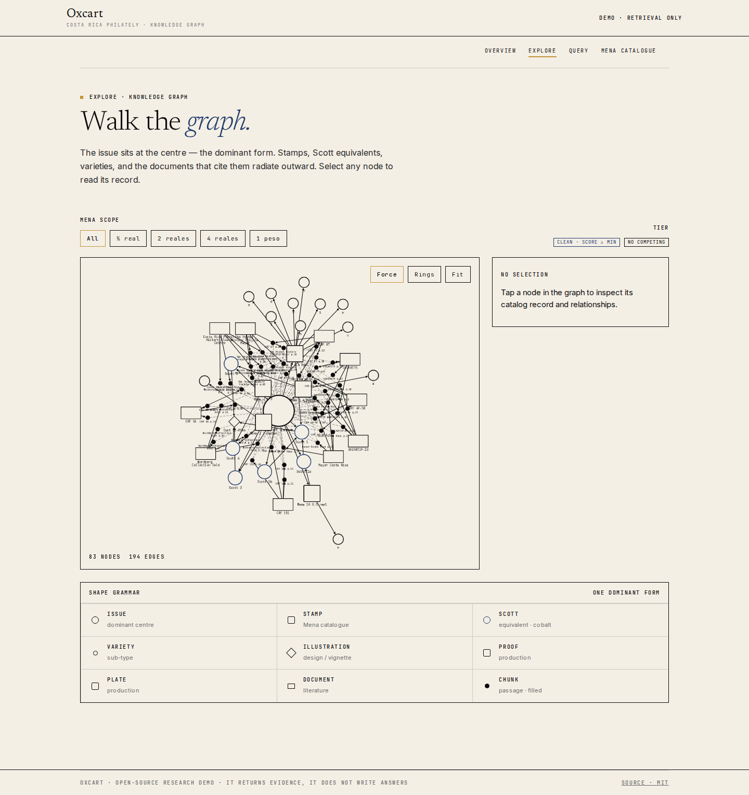

# The First Issue explorer

The explorer is a local app for the 1863 First Issue: its catalogue graph, its stamps, and the passages of the
literature linked to them, in four views (Overview, Explore, Query, and the Mena Catalogue by year). It runs
locally and writes no answer: its query path makes no language-model call, unlike the question page at
[oxcart.chat](https://oxcart.chat), which writes a short answer with citations.

<p align="center">
  
</p>

Start both servers as in the [README](../README.md#run-it-locally) and open <http://localhost:3000/research>.
Its routes are listed in [backend/README.md](../backend/README.md#the-explorers-routes) and its views in
[frontend/README.md](../frontend/README.md).

## 1. How the literature and the catalogue were indexed

```
Scanned literature (PDF)                       Mena 2018 catalogue
        │                                              │
        ▼                                              ▼
 Parse layout and text (Dolphin)              Parse into structured issues
        │                                     (pipeline/mena_*.py)
        ▼                                              │
 Chunk + enrich with philatelic metadata               ▼
 (pipeline/philatelic_*.py)                   Neo4j domain graph (neo4j_utils/)
        │                                     Issue → Stamp → Variety, Proof, Plate
        ▼                                              │
 Weaviate collection "Oxcart"                          │  + Scott equivalences
 192,680 chunks · 1,424 documents                      │
        │                                              │
        └────────► First Issue linker ◄────────────────┘
                   (pipeline/first_issue_graph/lexicon.py, coverage_scan.py)
                   scores every chunk; links passages to the issue and its stamps
                                 │
                                 ▼
                   Query: graph first, Weaviate as a short backup list
                   (oxcart/retrieve.py → FastAPI → Next.js)
```

## 2. What makes the retrieval more than a vector search

- **Graph first.** A question is answered from the graph: the catalogue record, the related varieties, proofs and
  plates, then the linked passages ranked by how strongly they refer to the issue. Weaviate adds only a short list
  of passages the graph did not already return (5 by default).
- **A rule-based linker, no language model.** `lexicon.py` scores each chunk with weighted signals (the year, the
  denominations and colours, the printer, plate and variety vocabulary, in English and Spanish). A chunk needs at
  least two independent strong signals to be linked.
- **Guards against look-alikes**, recorded on each link so they can be audited: `FOREIGN` (another country's first
  issue), `COMPETING` (later Costa Rican issues that reuse the same words), `FISCAL` (revenue stamps).
- **A quality tier.** The default evidence set is links with score 6 or more and no competing signal: 232 passages.
- **Two catalogue systems joined.** A Mena number resolves to its Scott equivalent and back.
- **Figures by page.** Images cropped from the cited pages are attached by document and page, not by similarity.
- **Nothing is generated.** The query path makes no language-model call. Its Weaviate search is keyword search
  (BM25) by default, with a hybrid pass added when an OpenAI key is set.

## 3. What improved the quality of the evidence

Measured in [pipeline/first_issue_graph/EVALUATION.md](../pipeline/first_issue_graph/EVALUATION.md):

| Change | Effect |
|---|---|
| Scan the whole corpus, not one journal | Documents with First Issue evidence: 155 → **296** |
| Collapse nested duplicate chunks (same passage stored at growing lengths) | One validation sample: 139 linked chunks → **15 distinct passages**, no distinct content lost |
| Add Spanish vocabulary to the linker (the corpus is about 70% Spanish) | About 298 chunks across 126 documents newly linked |
| Add the `FOREIGN`, `COMPETING` and `FISCAL` guards | About **90% precision** on a hand-audited 36-document sample |

Source documents returned for the four demo questions, before and after: 75 → 131 (main varieties of the first
issue), 33 → 68 (plate crack and its positions), 31 → 46 (1 peso covers), 30 → 49 (4 reales double transfer,
position 8).

The known remaining error source is oversized chunks that merge unrelated paragraphs.
[pipeline/first_issue_graph/EVALUATION.md](../pipeline/first_issue_graph/EVALUATION.md) describes it and the fix.

## 4. Which evaluations ran

| Check | Result |
|---|---|
| Coverage scan (`evaluate.py`) | 296 documents, 653 passages, 826 stamp mentions, 232 in the clean tier |
| Hand audit of linked passages (36-document sample) | about 90% precision; details in [pipeline/first_issue_graph/EVALUATION.md](../pipeline/first_issue_graph/EVALUATION.md) |
| Tests that need the stores (`backend/test_mena_backend.py`; the explorer's browser suite, `frontend/tests`) | last run on 2026-11-18, on a clean Linux machine against the stores: passed. Not run since; the question page was built after that date and is covered by the tests that run on every pull request |
| Reference run on a clean Linux machine | source-document counts for the four demo questions match `pipeline/first_issue_graph/EVALUATION.md` (131, 68, 46, 49, in the order above); the same passages come back in the same order before and after the changes that made the app portable |

## The graph

The Neo4j graph models the catalogue: `Issue`, `Stamp`, `Variety`, `Proof`, `Plate`, `PlatePosition`, and the
administrative context (`LegalAct`, `Person`, `Printer`, `ProductionOrder`). Typical paths:

```
(:Issue)-[:HAS_STAMP]->(:Stamp)-[:HAS_VARIETY]->(:Variety)-[:AT_POSITION]->(:PlatePosition)
(:Stamp)-[:EQUIVALENT_TO]->(:ScottStamp)
(:Chunk)-[:MENTIONS {score, signals}]->(:Issue)        (:Chunk)-[:MENTIONS_STAMP]->(:Stamp)
```

Queries and the full schema:
[neo4j_utils/neo4j_technical_guide_cypher_cookbook.md](../neo4j_utils/neo4j_technical_guide_cypher_cookbook.md)
and [pipeline/first_issue_graph/cypher_queries.md](../pipeline/first_issue_graph/cypher_queries.md).
